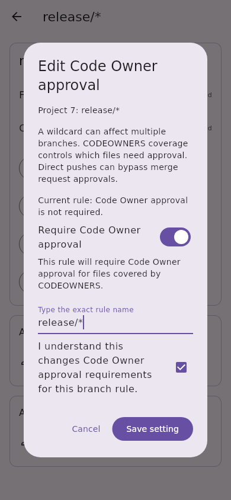
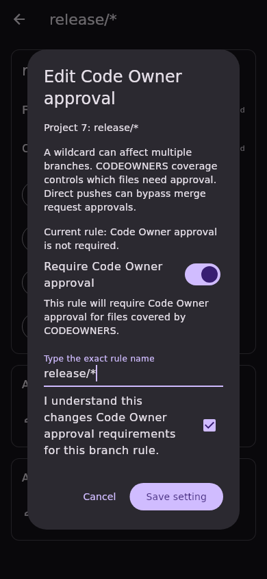
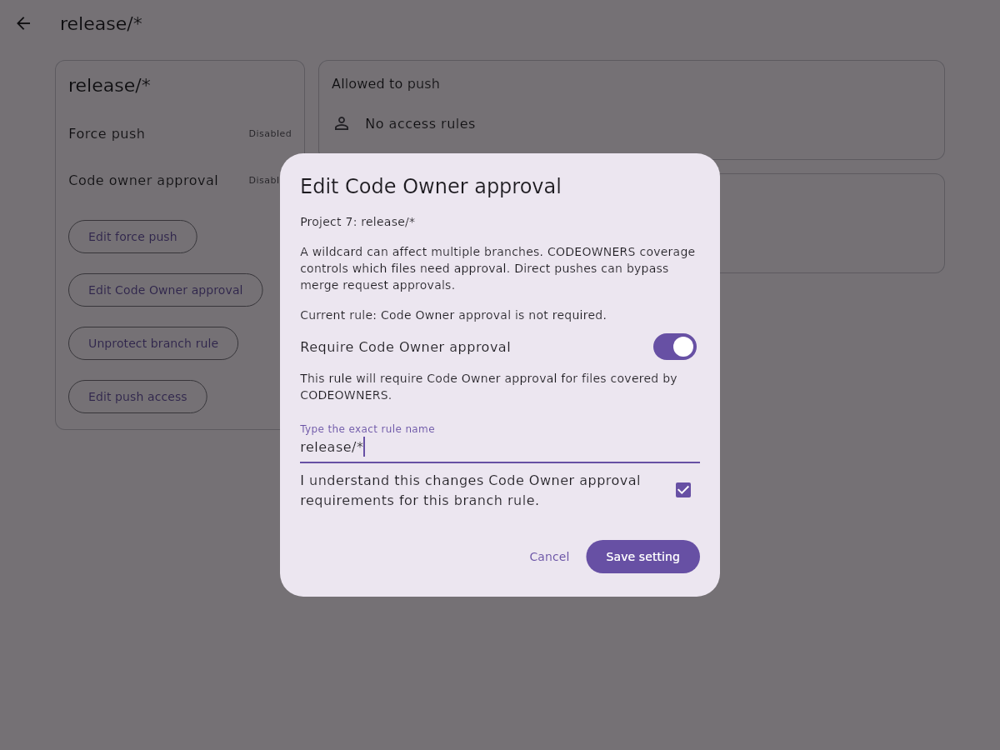
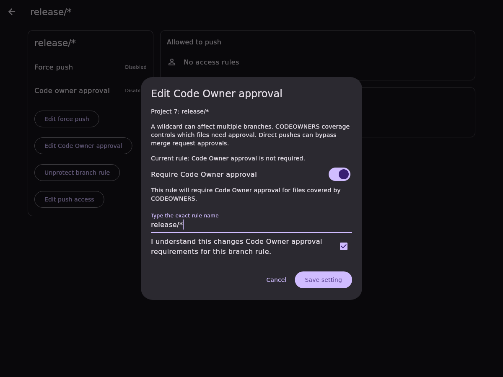

# Protected branch Code Owner approval editing

This slice adds one project protected-branch setting to the existing rule detail
screen: enable or disable the Code Owner approval requirement. Exact branch
names and wildcard rule names use the same responsive confirmation dialog.
Known inherited rules remain read-only. Other approval and access settings are
outside this slice.

## Confirmation and transport

Opening the dialog scans every protected-branch list page and reads the exact
rule again. The detail response must explicitly report a boolean
`code_owner_approval_required`; an omitted field cannot become an editable
`false` through the model's display default. The chooser stays hidden until
inspection succeeds. Missing, duplicate, inherited, malformed, or inconsistent
rules cannot be edited.

Saving requires a changed setting, the exact rule name, and an acknowledgement.
Changing the selection resets acknowledgement. Before dispatch, another complete
list scan and strict detail read must match the confirmed snapshot.

The client sends one `PATCH /projects/:id/protected_branches/:name` containing
only `code_owner_approval_required`. Project paths and rule names are encoded;
the authenticated instance supplies the base URL. The write follows no redirect
and disables automatic OAuth refresh/replay. HTTP failures become sanitized
domain exceptions before response parsing.

A successful response and a fresh strict detail read must both match the
snapshot with only the requested boolean changed. Comparison includes the rule
identity, force-push flag, inheritance, and all reported/modelled push, merge,
and unprotect access records. Unprotect records are optional in GitLab responses;
this check does not claim to preserve unreported or unknown server metadata.
Numeric IDs must be positive integers, with unique access-record IDs within each
list; numeric grant fields cannot be silently truncated by model parsing.

Failures or uncertain results lock saving until read-only reinspection. That
inspection clears the typed name and acknowledgement and adopts the observed
setting; another write requires a newly changed value and confirmation. Pending
writes block duplicate submissions and dismissal. Account changes disable the
dialog, and old-session completion cannot report success or invalidate the new
account's data. Confirmed writes refresh protected-branch list/detail and branch
browsing; uncertain attempted writes refresh only the current account's data.

## GitLab boundaries

GitLab documents this update and Code Owners as Premium/Ultimate functionality.
The dialog explains that a wildcard can affect multiple branches, CODEOWNERS
coverage determines which files need Code Owner approval, and direct pushes can
bypass merge request approvals. Disabling this flag does not remove other
approval rules. Server permissions and feature availability remain authoritative.

Preflight and follow-up reads are best-effort checks. The endpoint supplies no
atomic compare-and-set guarantee, so another actor can change the rule between
requests. No live GitLab instance, permission, tier, or version matrix has been
validated by this slice.

References: [update a protected branch](https://docs.gitlab.com/api/protected_branches/#update-a-protected-branch),
[Code Owners](https://docs.gitlab.com/user/project/codeowners/).

## Validation and screenshots

Tests were written and observed failing before implementation. API tests cover
the exact request body, encoded identity, explicit boolean parsing, malformed
records, typed HTTP failures, and no write refresh/replay. Controller tests cover
paginated inspection, stale/ambiguous/inherited rules, response and read-back
preservation, uncertain results, overlapping calls, and account replacement.
Widget tests cover both directions, exact-name/changed-value/renewed-consent
requirements, unknown flags, account replacement, and inherited rules across
five locales, mobile/tablet/desktop widths, and light/dark themes.

Local quality gates pass with Flutter 3.38.9: formatting, analysis, the English
language policy, 4,629 app tests, 3,208 API tests, and 344 other package tests
(8,181 total). CI and review approval remain separate requirements.

These synthetic widget captures use fixture data and real local fonts. They are
visual evidence, not live-instance permission validation.

| Viewport | Light | Dark |
| --- | --- | --- |
| Mobile, 390 × 844 |  |  |
| Desktop, 1200 × 900 |  |  |
