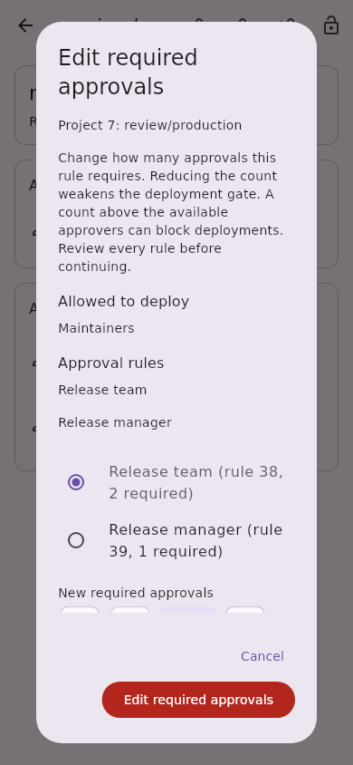
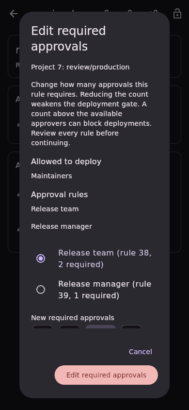
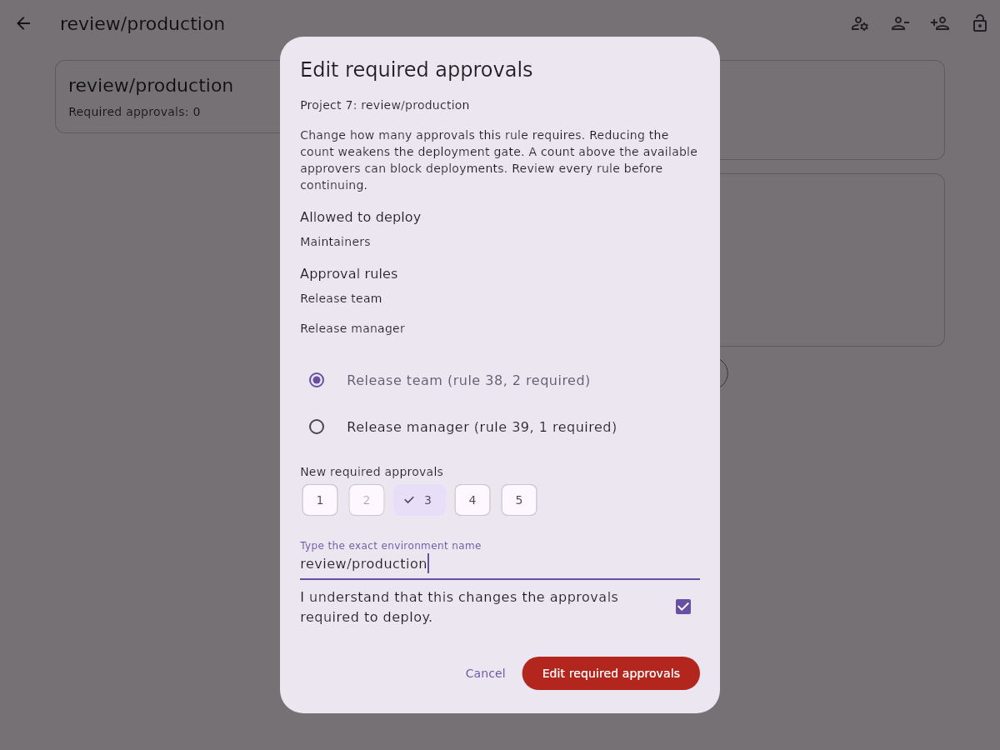
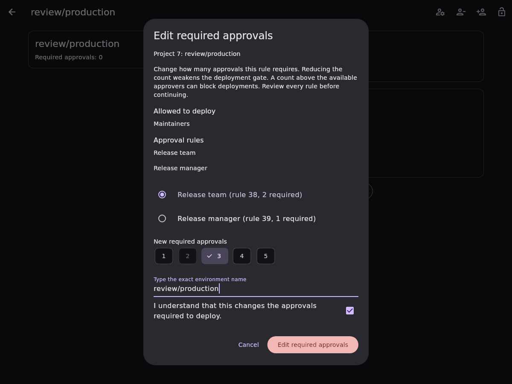

# Project protected environment approval-rule counts

Project protected-environment details expose an action beside the approval rules
to change one existing rule's required approval count. The existing responsive
route and account-bound repository are shared across platforms. Group rules and
rules with missing IDs or unknown counts remain read-only. Creating rules,
changing approvers, and editing the legacy environment-level count are separate
slices.

The [protected environments API](https://docs.gitlab.com/api/protected_environments/#example-update-an-approval_rule-record)
accepts nested approval-rule updates by record ID. This feature sends only
`approval_rules: [{id, required_approvals}]` in a single PUT. The supported count
range is 1 through 5, matching the
[server validation](https://gitlab.com/gitlab-org/gitlab/-/blob/master/ee/app/models/protected_environments/approval_rule.rb).
The project requires CI/CD and the Premium/Ultimate tier. Environment updates
require the permissions described in the
[deployment approvals documentation](https://docs.gitlab.com/ci/environments/deployment_approvals/).

The confirmation first reads every rule-list page and the complete matching
rule. It identifies each selectable approval rule by approver, record ID, and
current count. A changed count, the exact environment name, and acknowledgement
are required. Long approver labels wrap in the selection list so rule IDs and
current counts remain readable at narrow widths. Reducing the count weakens
the approval gate; exceeding the
available approver population can block deployments. This slice does not infer
eligible-approver cardinality from incomplete member or group lists.

Immediately before dispatch, a fresh complete snapshot must match the inspected
rule and still contain exactly one selected ID with a known supported count.
Invalid or unchanged counts and overlapping edits fail before dispatch. The
write disables redirects and automatic authentication replay. A follow-up
complete read must equal the intended snapshot, preserving every other approval
rule, deploy grant, approver identity, inheritance setting, description, and
legacy environment-level count. That legacy field is not treated as a sum of
the individual rule counts.

An uncertain write requires an explicit read-only reload and new confirmation
before another attempt. Account replacement blocks pending dispatch and keeps
old completions from updating the new session. The API has no atomic
compare-and-swap: these reads detect observed changes but cannot prevent an
external writer racing the request or undo an already dispatched write.

The captures use synthetic test fixtures and local fonts. Live permission,
version, and tier behavior has not been verified against a GitLab instance.

| Mobile light | Mobile dark |
| --- | --- |
|  |  |

| Desktop light | Desktop dark |
| --- | --- |
|  |  |
