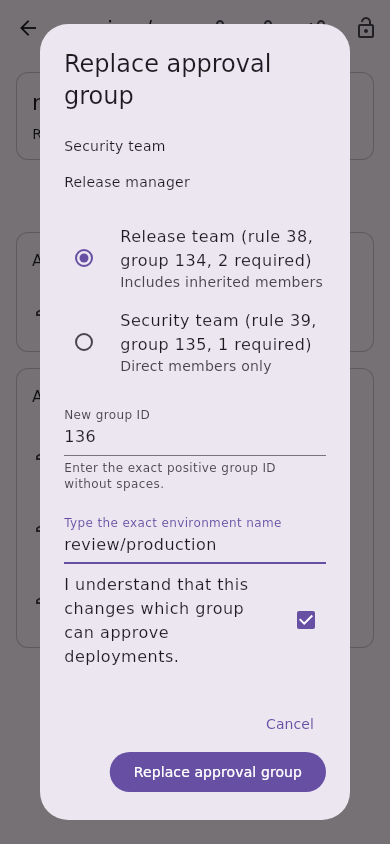
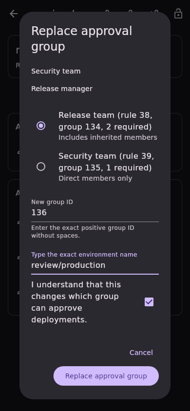
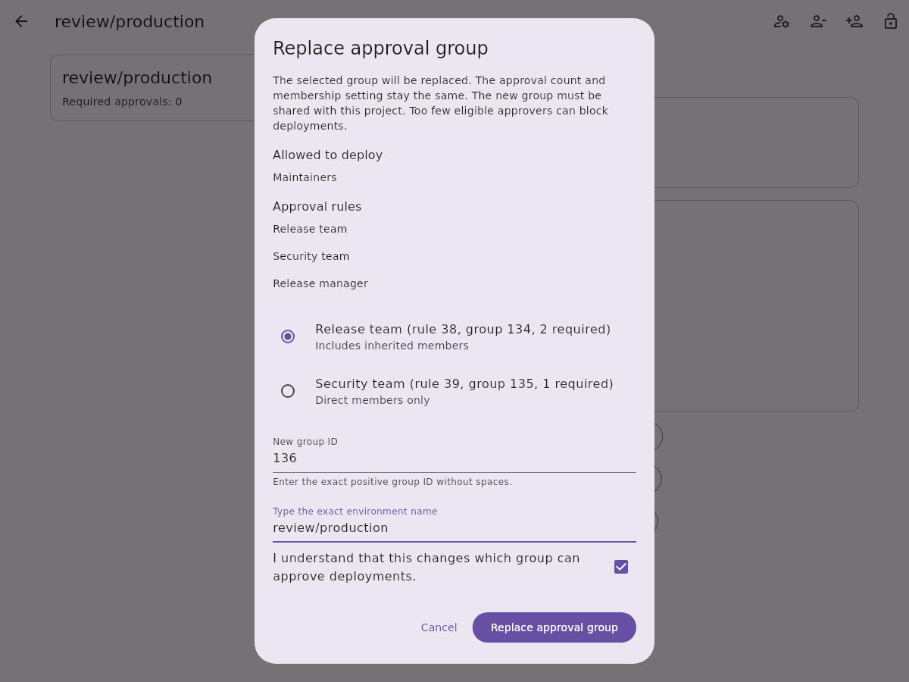
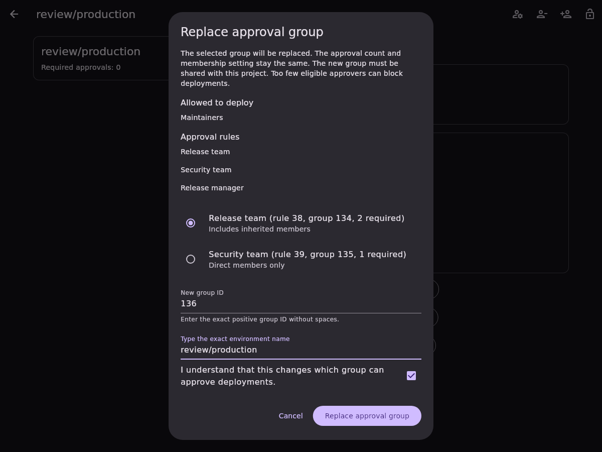

# Protected environment approval-group replacement

Issue [#656](https://github.com/Theorvane/LabFox/issues/656) adds replacement of
one existing group-based project protected-environment approval rule's group.
Group-level rules, user/role conversion, and shared-group discovery remain
separate slices. The same responsive dialog is used on every platform.

## Selection and confirmation

Only group-only rules with positive stable rule/group IDs, a positive approval
count and explicit direct/inherited membership (`0` or `1`) can be selected.
Unknown membership does not become an editable default. The dialog first scans
all inventory pages and strictly reads the complete exact environment.

Selectable rows show the current approver, rule/group IDs, approval count and
membership. Enter a different canonical positive group ID; a group already named
by any approval rule cannot be used again. Saving also requires the exact
environment name and acknowledgement. Any input edit resets acknowledgement;
changing the selected rule clears the new group ID as well. The dialog explains
that the new group must be shared with the project and insufficient eligible
approvers can block deployments.

## Transport and preservation

Before dispatch, a fresh complete inventory scan and strict detail read must
match the frozen snapshot. One `PUT /projects/:id/protected_environments/:name`
contains only the existing record ID and new group ID:

```json
{"approval_rules": [{"id": 38, "group_id": 136}]}
```

The authenticated instance supplies the base URL, and project paths/environment
names are encoded. The write follows no redirect and disables automatic OAuth
refresh/replay. HTTP failures are mapped before payload parsing. The strict
approval-group parser rejects incomplete arrays/counts, duplicate record IDs,
and lossy fractional numeric fields.

The response and an authoritative strict read-back must preserve the record ID,
required approvals, membership, every other approval/deploy grant, and legacy
count. The selected rule's server-provided display description may change with
the new group. This is the only additional field allowed to change; descriptions
on unrelated records are preserved. The complete response and read-back must
then agree, including the new selected description. A display description is
never used to identify or authorize a group.

Pending writes block inputs, dismissal and duplicate submission. Failed or
uncertain writes require read-only reinspection and renewed confirmation; rule
selection, group ID, typed name and acknowledgement are cleared. If an uncertain
write already applied, the observed group is now current and cannot authorize
the same replacement. Account changes lock confirmation; late old-session
results cannot report success or refresh the replacement account. Current-session
confirmed or uncertain attempted writes refresh project protection list/detail.

## Boundaries and evidence

GitLab requires Premium/Ultimate, project CI/CD, management permission, and a
project shared with the new group. Server checks remain authoritative. The app
does not enumerate approvers, guarantee the approval count can be met, or infer
live membership eligibility.

The endpoint offers no atomic compare-and-set, so another actor can change the
rule between preflight and confirmation. Comparisons cover reported/modelled
fields and cannot preserve unknown server metadata. Live role, tier and
self-hosted-version validation remains open.

API, controller and widget tests were observed failing before implementation.
They cover exact encoded transport/body, typed/malformed failures, no OAuth
replay, complete pagination, stale/ambiguous environments, unchanged/duplicate
group IDs, unknown/mixed-selector targets, description-aware preservation,
read-back agreement, uncertainty, overlap and account replacement. Widget tests
cover five locales at 320/800/1200 widths in both themes, preserving both direct
and inherited membership; existing approval-group addition and count editing
are included in the related regression suite. Full local quality-gate results
are recorded in the pull request.

Local quality gates pass with Flutter 3.38.9: formatting, analysis, the English
language policy, 4,790 app tests, 3,309 API tests, and 344 other package tests
(8,443 total). App and API suites were rerun after integrating the approved
membership-editing slice from `dev`. CI and review approval remain separate requirements.

Reference: [protected-environment update](https://docs.gitlab.com/api/protected_environments/#update-a-protected-environment).

## Synthetic screenshots

Fixture-only widget captures use real local fonts and show the confirmation
portion of the scrollable dialog. They do not validate live GitLab permissions.

| Viewport | Light | Dark |
| --- | --- | --- |
| Mobile, 390 × 844 |  |  |
| Desktop, 1200 × 900 |  |  |
