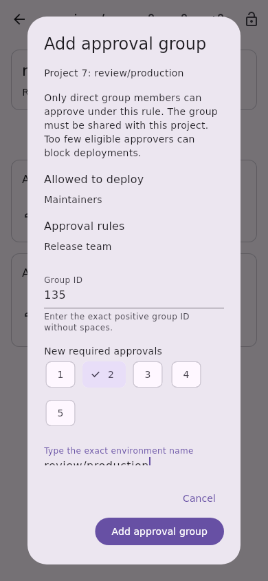
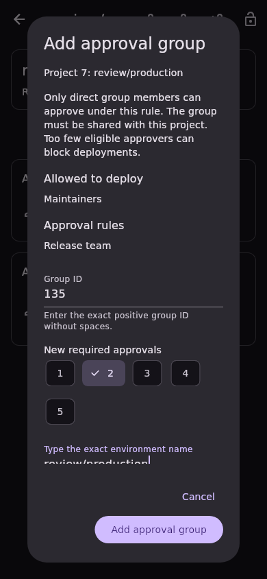
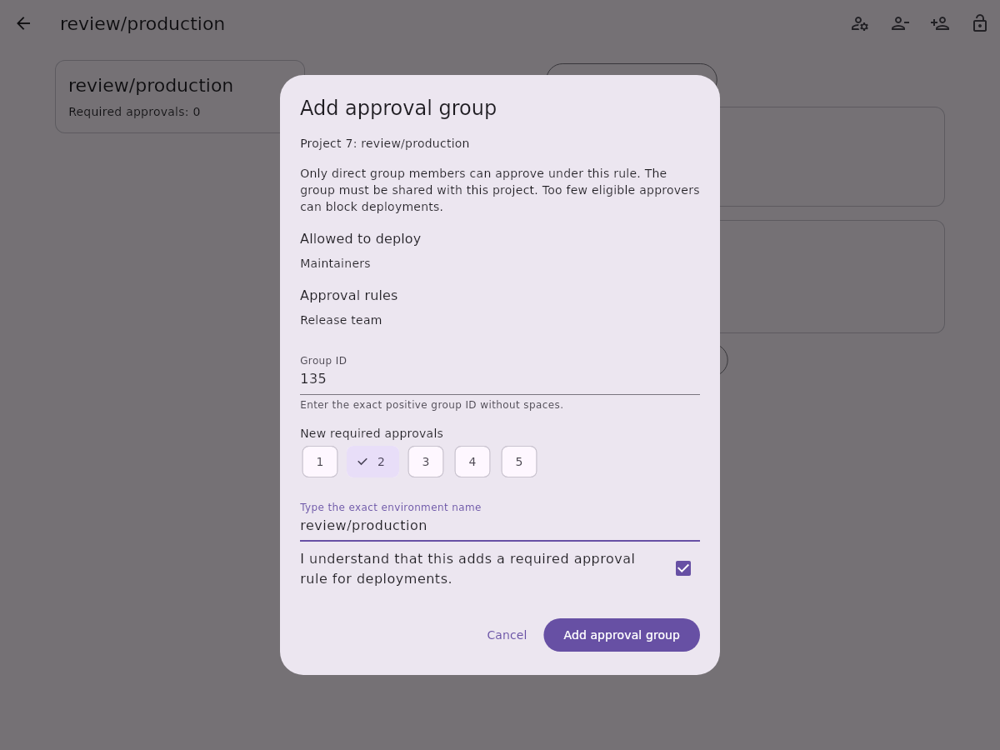
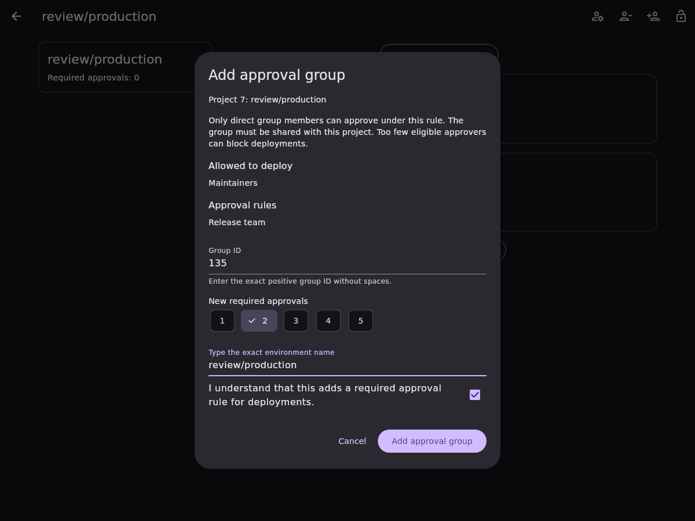

# Protected environment approval-group addition

Issue [#652](https://github.com/Theorvane/LabFox/issues/652) adds one group-based
approval rule to an existing project protected environment. The same dialog
serves mobile, tablet, and desktop. Group-level environment rules remain
read-only. Group discovery, user/role approval grants, approval-group replacement,
and inherited-membership selection are separate slices.

## User flow

The project detail screen exposes **Add approval group**, including when the
current approval-rule list is empty. Opening it completes a paginated inventory
scan and strictly reads the exact environment. Saving requires a canonical
positive group ID, an explicit selection of 1–5 approvals, the exact environment
name, and acknowledgement. Editing the ID, count, or name resets acknowledgement.
A group already represented in any approval rule cannot be added again.

The new rule uses `group_inheritance_type: 0`: only direct group members are
considered under this rule. GitLab requires the group to be shared with the
project. The dialog explains this requirement and warns that too few eligible
approvers can block deployments. The 1–5 selector is this slice's supported input
range; it is not a claim about every server version's maximum.

## Request and confirmation

Before dispatch, another complete inventory scan and strict detail read must
match the confirmed snapshot. The client sends one
`PUT /projects/:id/protected_environments/:name` with this body:

```json
{
  "approval_rules": [
    {"group_id": 135, "required_approvals": 2, "group_inheritance_type": 0}
  ]
}
```

No existing record ID or deploy-access replacement is sent. The injected instance
supplies the base URL; project paths and environment names are encoded. The
write follows no redirect and disables automatic OAuth refresh/replay. HTTP
errors are mapped before parsing, with sanitized domain failures.

The write response and a fresh authoritative detail read must both preserve all
modelled existing deploy and approval records and the legacy approval count.
Exactly one new approval record must exist, with a positive unused approval-rule
ID, the requested group/count, direct membership, and no user/role selector. The
two confirmed snapshots must also match each other. Strict reads require both
grant arrays, explicit legacy approval count, unique positive IDs within each
array, and positive reported approval counts. Numeric grant fields must be
integers; fractional values cannot be silently truncated by generated parsing.

Pending writes block input, dismissal, and duplicate submission. Failed or
uncertain writes require read-only reinspection, which clears the group ID,
count, typed name, and acknowledgement. An already-applied rule is then treated
as a duplicate. Account replacement locks the dialog; late old-session results
cannot report success or refresh the replacement account. Only current-session
confirmed or uncertain attempted writes invalidate project rule list/detail.

## Boundaries and validation

GitLab documents protected environments as Premium/Ultimate functionality,
requires project CI/CD to be enabled, and enforces management permissions and
shared-group eligibility on the server. This slice does not enumerate eligible
approvers or guarantee that the requested count can be satisfied. A user can
give only one approval per deployment even when present in multiple groups.
Existing approval rules continue to apply.

The endpoint provides no atomic compare-and-set. Preflight and confirmation are
best-effort checks and cannot prevent another actor changing the rule between
requests. Comparison covers reported/modelled fields, not unknown server
metadata. No live role, tier, or self-hosted version matrix has been validated.

API, controller, and widget tests were observed failing before implementation.
Coverage includes exact transport/body, malformed and status-first responses,
no automatic write replay, pagination, duplicate/stale rules, response/read-back
preservation, overlapping calls, uncertainty, account replacement, and five
locales across 320/800/1200 widths and both themes. Full local quality-gate
results are recorded in the pull request.

Local quality gates pass with Flutter 3.38.9: formatting, analysis, the English
language policy, 4,661 app tests, 3,230 API tests, and 344 other package tests
(8,235 total). App and API suites were rerun after integrating the approved
approval-removal slice from `dev`. CI and review approval remain separate requirements.

References: [protected-environment update](https://docs.gitlab.com/api/protected_environments/#update-a-protected-environment),
[deployment approvals](https://docs.gitlab.com/ci/environments/deployment_approvals/).

## Synthetic screenshots

These fixture-only widget captures use real local fonts. They demonstrate layout
and confirmation, not live GitLab permission validation.

| Viewport | Light | Dark |
| --- | --- | --- |
| Mobile, 390 × 844 |  |  |
| Desktop, 1200 × 900 |  |  |
