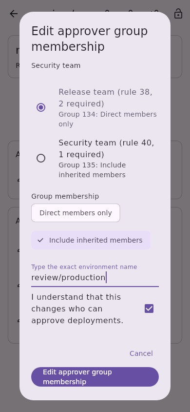
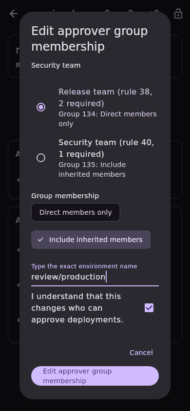
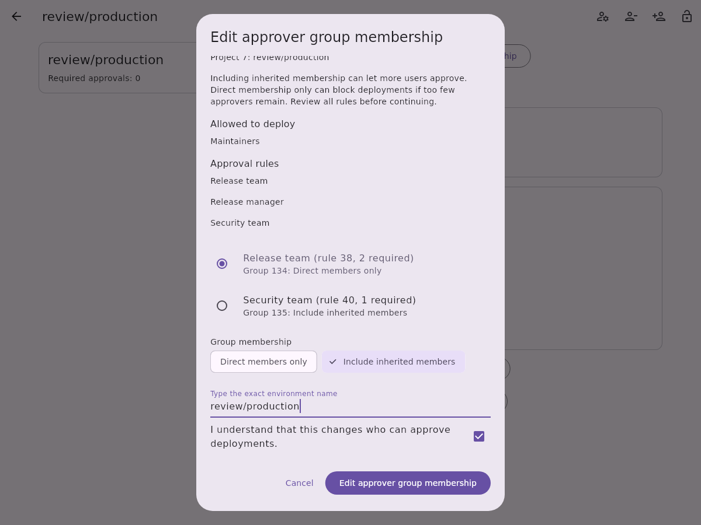
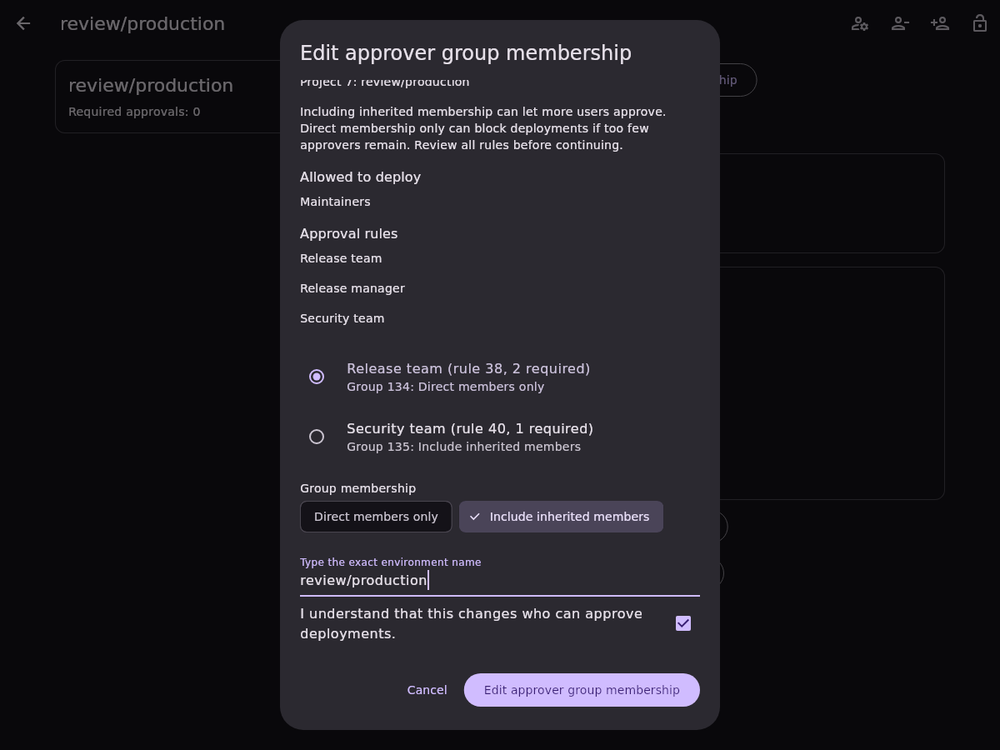

# Protected environment approval-group membership editing

Issue [#654](https://github.com/Theorvane/LabFox/issues/654) adds membership-scope
editing for one existing group-based project protected-environment approval rule.
The choices are GitLab's `group_inheritance_type` values: `0` for direct group
membership only and `1` to include inherited membership. The same responsive
dialog serves every supported platform. Group-level environment rules remain
read-only.

## Selection and confirmation

The detail screen offers editing only when a group rule reports positive stable
rule/group IDs, a positive approval count, no user/role selector, and an explicit
current membership value of `0` or `1`. Missing or future membership values do
not become a direct-membership default.

Opening the dialog scans every inventory page to establish an unambiguous exact
environment and reads its complete rule through the strict approval-group read.
Selectable rows identify the approver, rule ID, approval count, group ID, and
current membership. Selecting a rule displays its actual current setting. Saving
requires a changed membership choice, the exact environment name, and
acknowledgement; changing the rule, membership, or name resets acknowledgement.

The dialog warns that including inherited membership can let more users approve,
while narrowing membership can block deployments when too few eligible approvers
remain. It does not enumerate eligible members or infer that a deployment can
satisfy its approval rules.

## Request and state checks

Another complete inventory scan and strict detail read must match the frozen
snapshot immediately before dispatch. The client sends one
`PUT /projects/:id/protected_environments/:name` containing only:

```json
{"approval_rules": [{"id": 38, "group_inheritance_type": 1}]}
```

Project paths and exact environment names are encoded, and the authenticated
instance supplies the base URL. The write follows no redirect and disables
automatic OAuth refresh/replay. HTTP errors are mapped before payload parsing.

The response must identify exactly one group-based target with the requested
membership. Both the complete write response and a fresh authoritative strict
read must match the frozen snapshot with only that target's membership changed.
The group, stable rule ID, required approvals, other approval records, deploy
grants, descriptions, and legacy approval count are preserved as modelled.
Existing strict reads reject missing arrays/counts, duplicate record IDs, and
fractional numeric fields before generated model parsing can supply defaults or
truncate values.

Pending writes block edits, dismissal, and duplicate submission. Any failed or
uncertain attempt requires read-only reinspection, which clears rule selection,
typed name, membership choice, and acknowledgement. An already-applied change
then becomes the observed current value and cannot authorize the same write.
Account changes lock the dialog; late results cannot report success or refresh
the replacement account. Current-session confirmed or uncertain attempted writes
refresh project protection list/detail.

## Boundaries and evidence

GitLab requires Premium/Ultimate, project CI/CD, appropriate management
permissions, and a group shared with the project. The server remains
authoritative. Group replacement, user/role grant editing, group-level writes,
and member discovery are separate slices.

The endpoint offers no atomic compare-and-set. Another actor can change the
rule between requests despite preflight and read-back checks. Preservation
compares reported/modelled fields and cannot protect unknown server metadata.
No live GitLab role, tier, or self-hosted version matrix was validated.

API, controller, and widget tests were observed failing before implementation.
Coverage includes both membership directions, exact request body and encoding,
malformed/status-first failures, no OAuth replay, complete pagination, stale or
ambiguous environments, unchanged/unknown/non-group targets, response/read-back
preservation, uncertainty, overlap, account replacement, and five locales across
320/800/1200 widths in light and dark themes. Existing approval-group addition
and approval-count editing remain covered by the related regression suite.
Full local quality-gate results are recorded in the pull request.

Local quality gates pass with Flutter 3.38.9: formatting, analysis, the English
language policy, 4,747 app tests, 3,284 API tests, and 344 other package tests
(8,375 total). CI and review approval remain separate requirements.

References: [group inheritance types](https://docs.gitlab.com/api/protected_environments/#group-inheritance-types),
[protected-environment update](https://docs.gitlab.com/api/protected_environments/#update-a-protected-environment).

## Synthetic screenshots

Fixture-only captures use real local fonts and show the confirmation portion of
the scrollable dialog. They demonstrate layout, not live permission validation.

| Viewport | Light | Dark |
| --- | --- | --- |
| Mobile, 390 × 844 |  |  |
| Desktop, 1200 × 900 |  |  |
