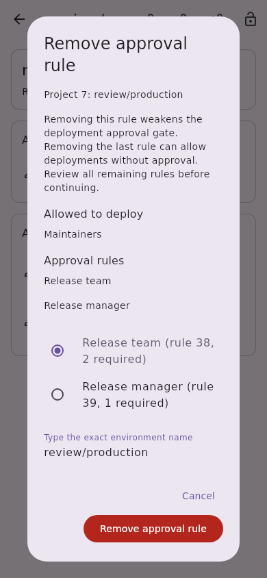
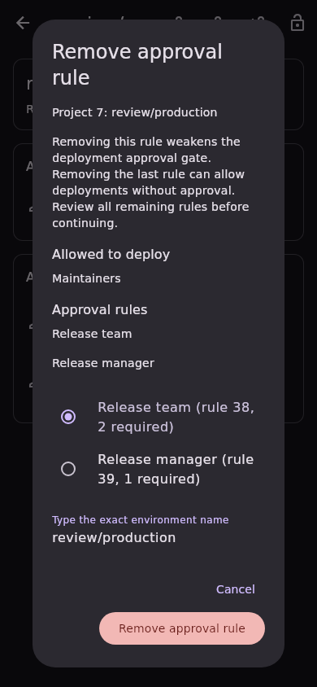
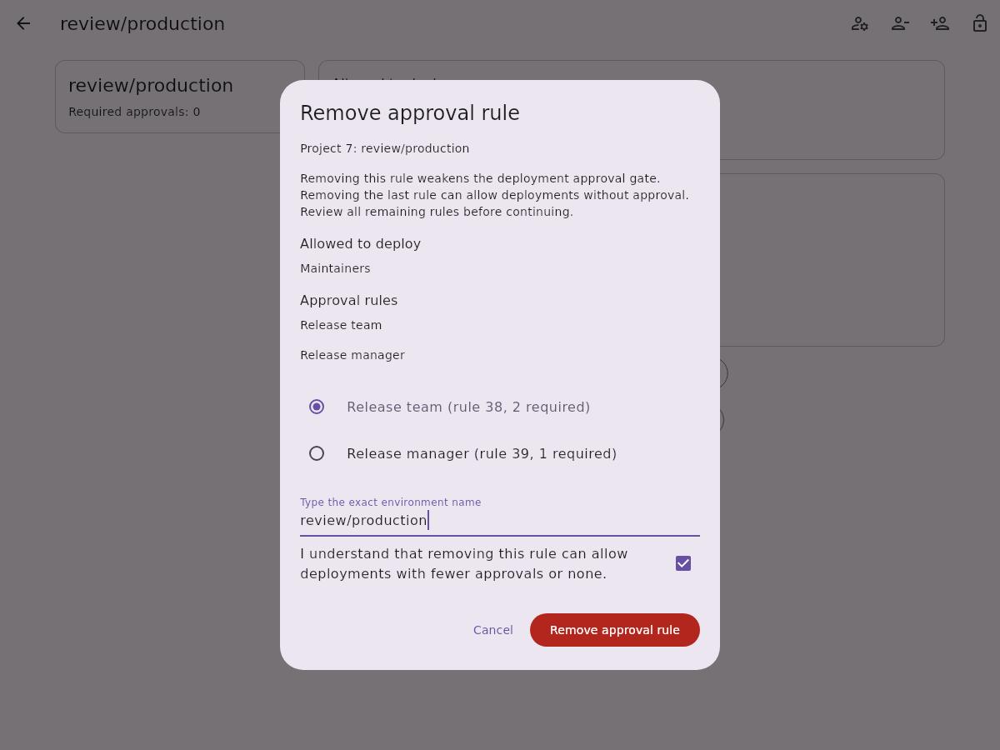
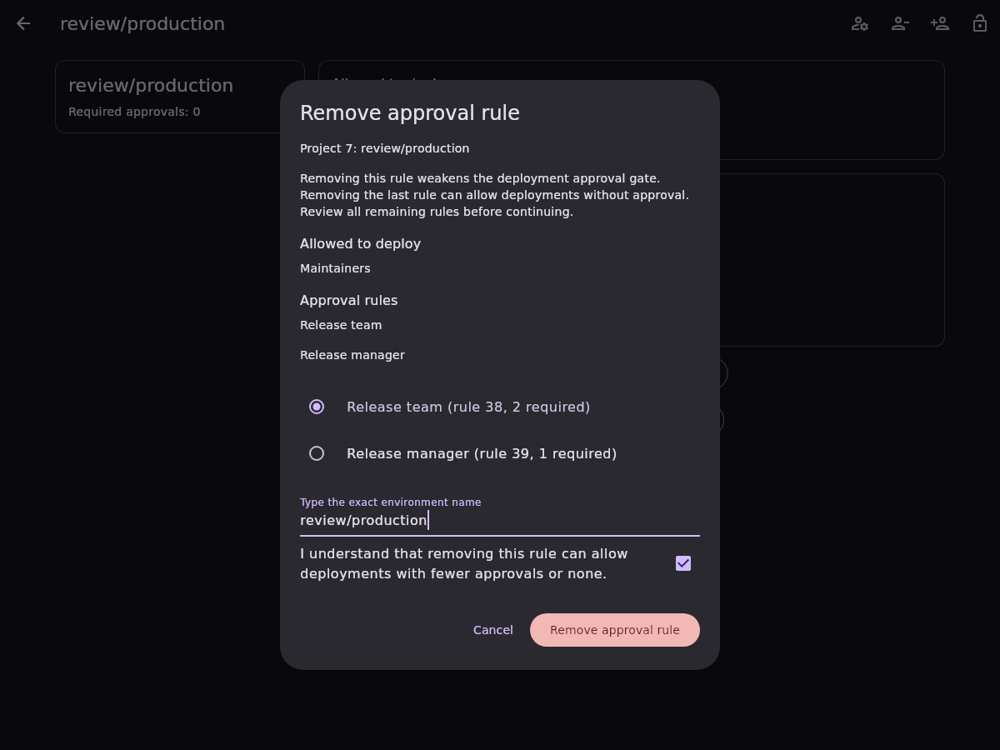

# Removing a project protected environment approval rule

Project protected-environment details expose an action beside approval rules to
remove one existing rule by its server-assigned ID. The same responsive dialog
and account-bound repository serve every platform. Group rules and rules with
unknown IDs or unsupported approval counts remain read-only.

The [documented nested update](https://docs.gitlab.com/api/protected_environments/#example-delete-an-approval_rule-record)
uses `approval_rules: [{id, _destroy: true}]` in one PUT. This feature does not
delete the environment or its protection rule. It requires the GitLab tier,
enabled project CI/CD, and permissions required by the protected environments
API. Live version, tier, and permission behavior has not been verified here.

The confirmation first inspects every rule-list page and the complete matching
rule. A wrapping radio list identifies the approver, rule ID, and current count.
The user must select a rule, type the exact environment name, and acknowledge the
effect. Removing a rule weakens the deployment approval gate; removing the last
rule can allow deployments without approval. The legacy environment-level count
is preserved rather than inferred from the remaining rules.

Before dispatch, a fresh complete snapshot must match the confirmed snapshot and
still contain exactly one selected positive ID with a known count from 1 through
5. Duplicate/missing targets, stale rules, overlapping removals, and account
replacement block dispatch. The write disables redirects and automatic
authentication replay. HTTP 200 must confirm the selected ID is absent, and a
complete follow-up read must equal the intended snapshot. Every other approval
rule, deploy grant, approver field, inheritance setting, and legacy count must
remain unchanged. Removing the last approval rule is covered explicitly.

Uncertain responses require an explicit read-only reload and renewed confirmation
before another attempt. Old-account completions cannot update the new session.
The API provides no atomic compare-and-swap: preflight/postflight detect observed
changes but cannot prevent an external writer racing the request or undo a write
already dispatched for the previous account.

These screenshots use synthetic test fixtures and local fonts.

| Mobile light | Mobile dark |
| --- | --- |
|  |  |

| Desktop light | Desktop dark |
| --- | --- |
|  |  |
