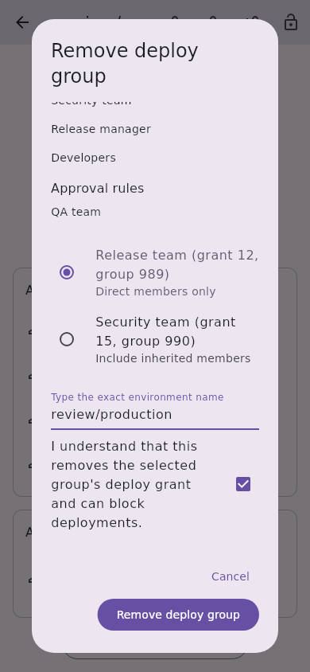
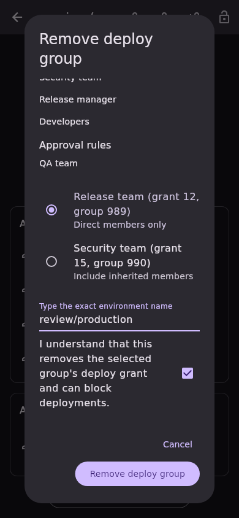
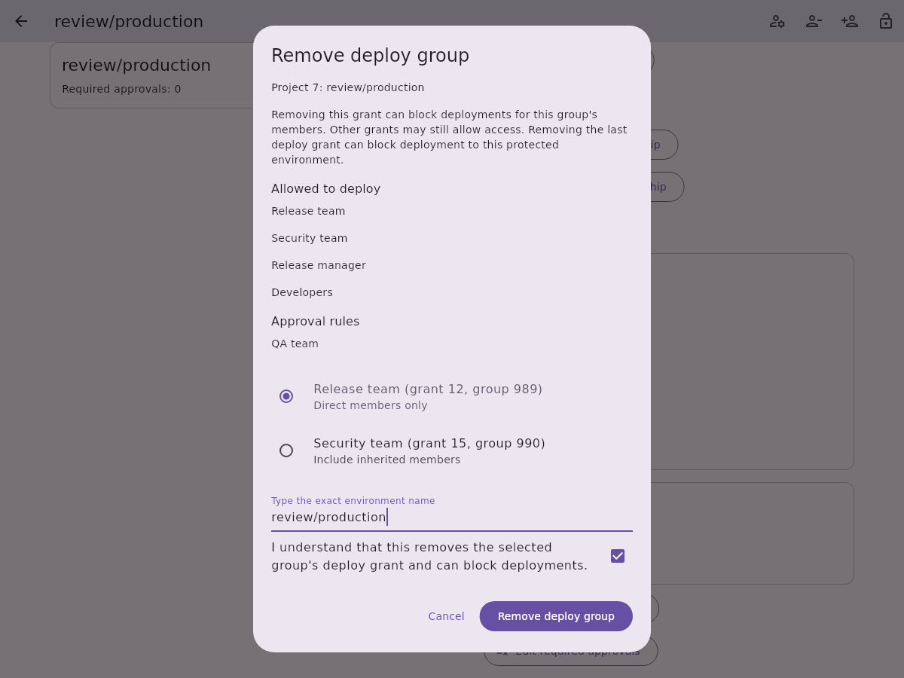
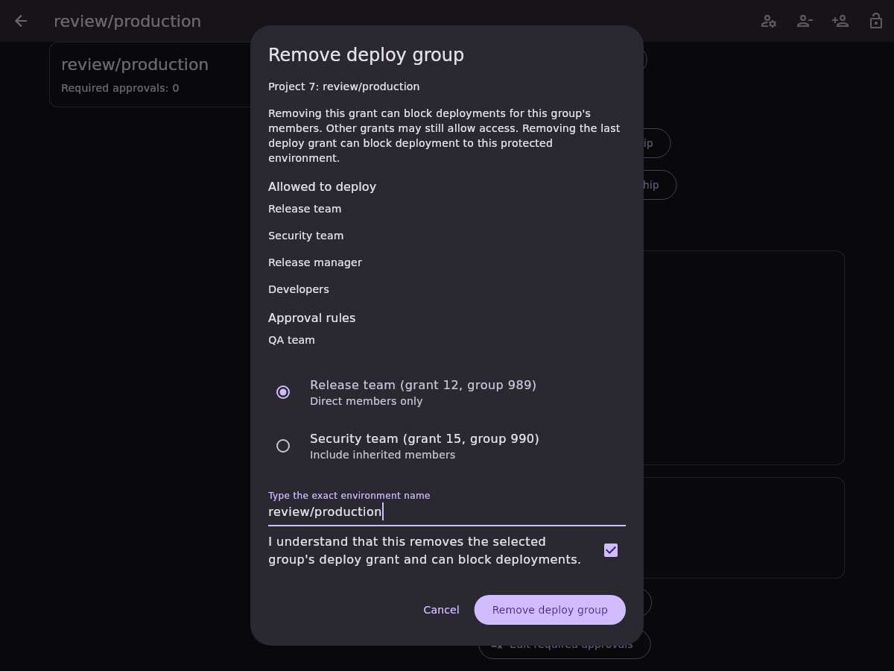

# Protected environment deploy-group removal

Issue [#662](https://github.com/Theorvane/LabFox/issues/662) removes one existing
group-based project protected-environment deploy grant. The environment remains
protected, including when its final deploy grant is removed. Group-level rules
remain read-only.

## Selection and confirmation

Only records with positive stable grant/group IDs, no user selector and explicit
direct (`0`) or inherited (`1`) membership are selectable. Unknown membership and
role/user-only grants are read-only in this slice. Reported role metadata on a
group grant does not turn it into a role-only record.

One responsive dialog shows all deploy and approval grants and identifies each
selectable group by description, grant ID, group ID and current membership.
Removal requires a selection, the exact environment name and acknowledgement.
Changing the selection or typed name resets acknowledgement. The warning explains
that members may lose deployment access, other grants can still allow access,
and removing the last deploy grant can block deployment to the protected environment.

## Transport and preservation

Opening the dialog scans every protected-environment inventory page and strictly
reads the complete rule. Before dispatch, a fresh scan/detail read must match the
confirmed snapshot; stale, missing, ambiguous or duplicate target records fail
without a write.

One `PUT /projects/:id/protected_environments/:name` sends only:

```json
{"deploy_access_levels": [{"id": 12, "_destroy": true}]}
```

No environment unprotection request is sent. Project paths and exact names are
encoded, the authenticated instance provides the base URL, redirects are disabled
and OAuth failures cannot trigger automatic mutation replay. Status errors are
mapped before parsing.

The strict full-rule reader requires both grant arrays, an explicit nonnegative
legacy count, positive unique IDs within each array and integral numeric metadata.
The response and authoritative read-back must equal the snapshot with exactly the
selected grant removed. Every remaining deploy grant, description, approval rule
and approval count must match. Empty deploy access is an explicit successful
result when the selected group was the final grant; an absent or partial rule is
not treated as confirmed removal.

Pending operations block inputs, dismissal and repeated submission. Failed or
uncertain writes require read-only reinspection and fresh confirmation. Reloading
clears selection, typed name and acknowledgement; a removed grant disappears and
cannot authorize another write. Account replacement locks the dialog and prevents
pre-dispatch writes; late old-session completion cannot report success or refresh
the replacement account. Current-session confirmed or uncertain attempted writes
refresh project protection list/detail providers.

## Boundaries and evidence

Premium/Ultimate, enabled project CI/CD and protected-environment management
permissions are server requirements. No live role/tier/self-hosted version matrix
was validated. The endpoint offers no atomic compare-and-set, so preflight and
read-back cannot eliminate concurrent changes. Preservation covers modelled
fields rather than unknown server metadata. Group membership and project sharing
are not changed by removing this environment-specific grant.

API, controller and widget tests were observed failing before implementation.
Coverage includes both membership modes, exact encoded request/body, last-grant
removal, strict/status-first failures, no OAuth replay, complete pagination,
stale/ambiguous/missing/duplicate targets, non-group/unknown selectors, preservation,
uncertain outcomes, overlapping commands, pending locks and account replacement.
Five locales at 320/800/1200 widths cover both themes. Full local suites passed
8,653 tests: app 4,922; API 3,387; design system 135; models 204; secure storage 5.
Static analysis reported no issues; root formatting changed no files, and the
CI English-language policy passed.

Reference: [delete a deploy access record](https://docs.gitlab.com/api/protected_environments/#example-delete-a-deploy_access_level-record).

## Synthetic screenshots

Fixture-only captures show the confirmation portion of the scrollable dialog;
they do not validate live GitLab permissions.

| Viewport | Light | Dark |
| --- | --- | --- |
| Mobile, 390 × 844 |  |  |
| Desktop, 1200 × 900 |  |  |
