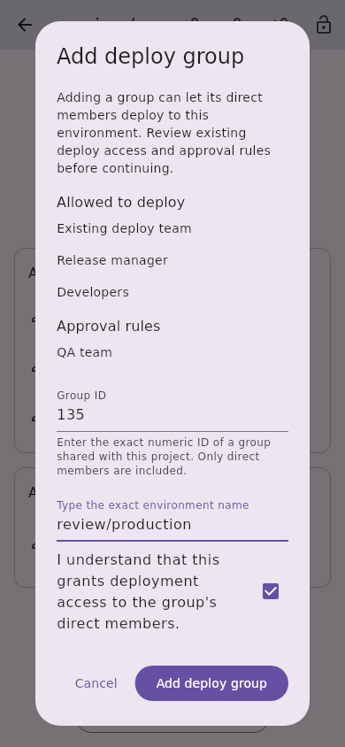
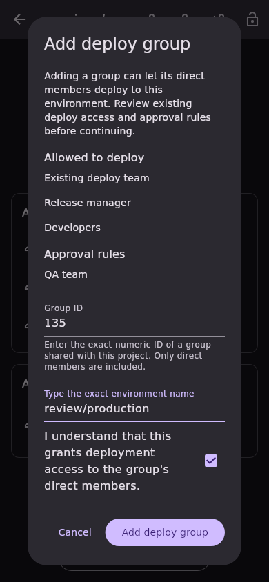
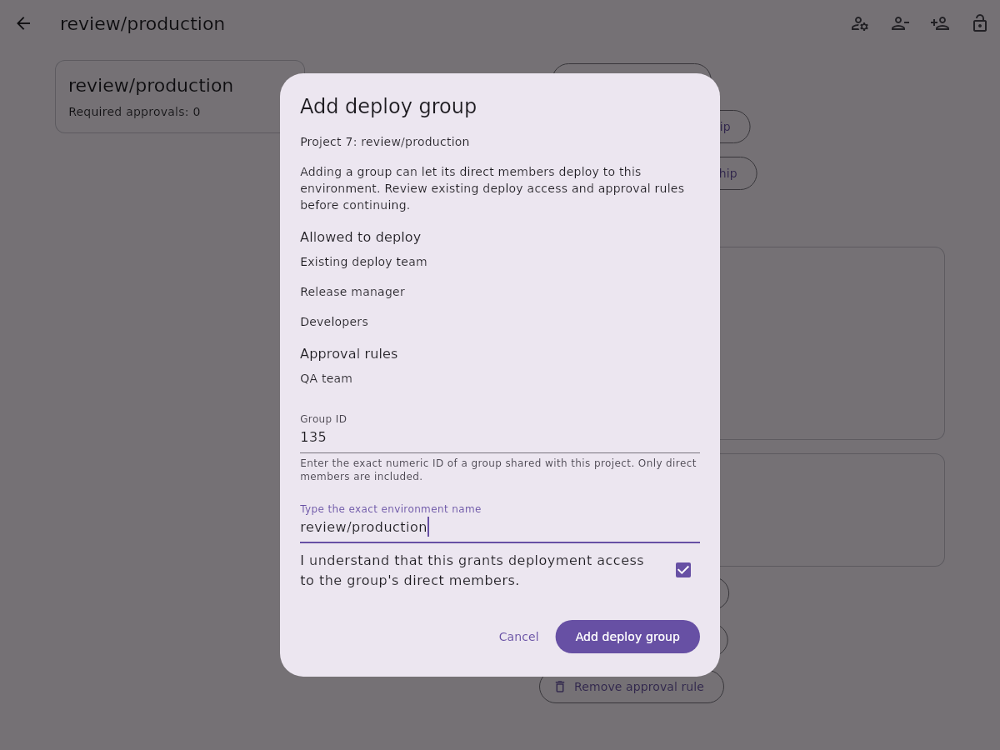
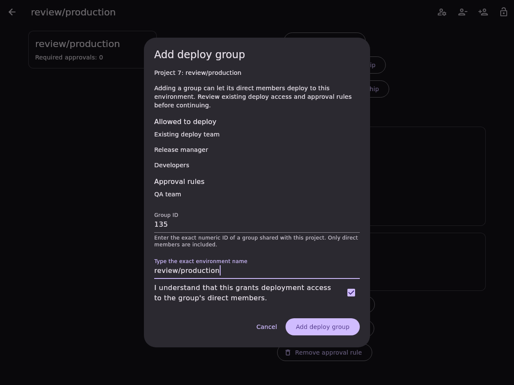

# Protected environment deploy-group addition

Issue [#660](https://github.com/Theorvane/LabFox/issues/660) adds one shared group
by exact numeric ID to an existing project's protected-environment deploy access.
The new grant explicitly uses direct membership (`group_inheritance_type: 0`).
Existing deploy-group membership editing can change that setting separately.
Group-level rules remain read-only in this slice.

## Selection and confirmation

The shared responsive dialog shows existing deploy access and approval rules,
warns about granting deployment access, and requires an exact environment name
and acknowledgement. IDs must be positive canonical decimal integers: whitespace,
signs, leading zeros and fractions are rejected. Changing either text field
resets acknowledgement. A group with any existing deploy grant is blocked;
having an approval rule for that group does not block deployment access addition.

The group must already be shared with the project. The app does not enumerate
eligible groups or members, infer live deployment eligibility, or add project
sharing as a side effect. The server validates the requested group.

## Transport and preservation

Opening the dialog completes the protected-environment inventory and a strict
full-rule read. Immediately before dispatch, another complete scan and strict
read must match the frozen confirmation snapshot. Missing, duplicate or changed
environment rules fail before the write.

One request to `PUT /projects/:id/protected_environments/:name` sends:

```json
{"deploy_access_levels": [{"group_id": 135, "group_inheritance_type": 0}]}
```

There is no existing grant ID or role/user selector in the request. Project paths
and environment names are encoded, the authenticated instance supplies the base
URL, redirects are disabled and OAuth failures cannot trigger automatic replay.
HTTP status errors are mapped before payload parsing. The existing strict
deploy-group reader requires both grant arrays, an explicit nonnegative legacy
count, positive unique IDs within each array and integral numeric metadata.

The response and authoritative read-back must contain exactly one new stable
grant for the requested group with direct membership and no user selector.
Reported role metadata on the new group grant is allowed; GitLab can return
`access_level` alongside `group_id`. Every existing deploy grant, approval rule,
description and legacy approval count must be preserved. Response and read-back
must agree on the complete model, including the new grant's metadata.

Pending operations block inputs, dismissal and duplicate submission. Failed or
uncertain writes require read-only reinspection and fresh confirmation. Reloading
clears the ID, exact name and acknowledgement; an already-applied grant becomes
a duplicate and cannot authorize the same write. Account replacement locks the
dialog, prevents pre-dispatch writes and suppresses late old-session success or
replacement-account invalidation. Current-session attempted writes refresh list
and detail providers even when their outcome is uncertain.

## Boundaries and validation

Premium/Ultimate, enabled project CI/CD, management permissions and project/group
sharing are server requirements. No live role, tier or self-hosted version matrix
was validated. The endpoint has no atomic compare-and-set: another actor can
change a rule between preflight and read-back. Preservation covers reported,
modelled fields rather than unknown server metadata.

API, controller and widget tests were observed failing before implementation.
Coverage includes exact encoded requests, status-first and malformed-response
failures, no OAuth replay, all inventory pages, missing/stale/ambiguous rules,
duplicate group rejection, role metadata preservation, changed responses and
read-backs, uncertain writes, pending locks and account isolation. Five locales
are tested at 320/800/1200 widths in light and dark themes. Full local suites
passed 8,582 tests: app 4,876; API 3,362; design system 135; models 204;
secure storage 5. Static analysis reported no issues; root formatting changed
no files, and the CI English-language policy passed.

References: [update endpoint](https://docs.gitlab.com/api/protected_environments/#update-a-protected-environment),
[group membership](https://docs.gitlab.com/api/protected_environments/#group-inheritance-types).

## Synthetic screenshots

Fixture-only widget captures show the confirmation portion of the scrollable
dialog. They do not validate live GitLab permissions.

| Viewport | Light | Dark |
| --- | --- | --- |
| Mobile, 390 × 844 |  |  |
| Desktop, 1200 × 900 |  |  |
