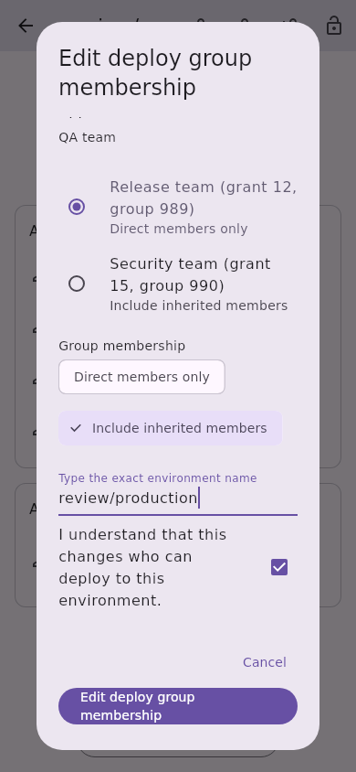
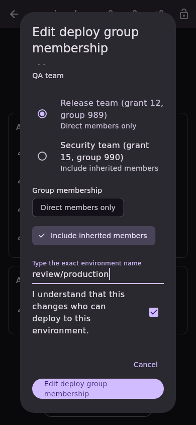
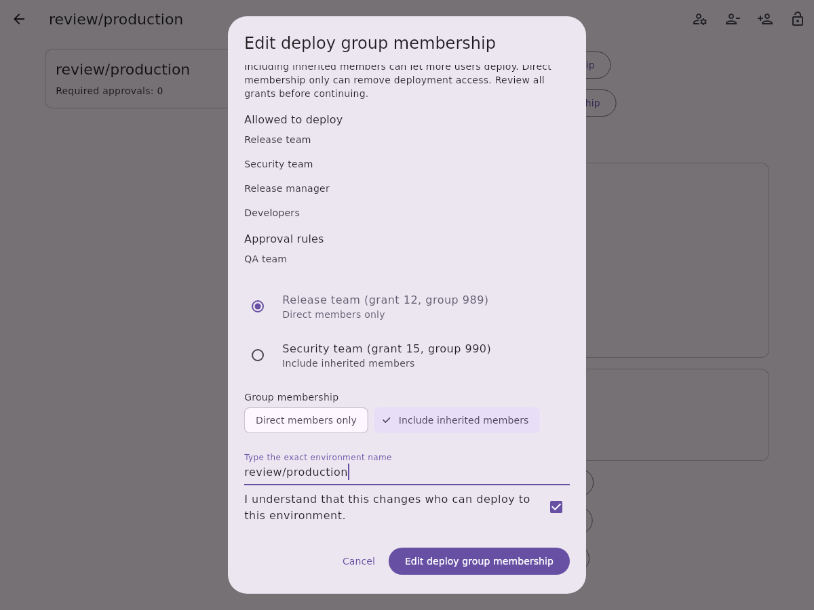
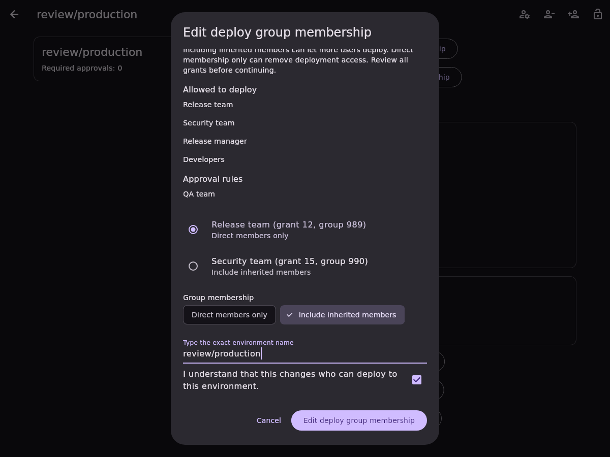

# Protected environment deploy-group membership editing

Issue [#658](https://github.com/Theorvane/LabFox/issues/658) adds direct/inherited
membership editing for one existing group-based project protected-environment
deploy grant. GitLab defines `group_inheritance_type` as `0` for direct membership
only and `1` for inherited membership. The same responsive dialog is used on
every supported platform; group-level environment rules remain read-only.

## Selection and confirmation

Only grants with positive stable grant/group IDs, no user selector, and an
explicit current membership of `0` or `1` can be selected. Unknown membership
does not become a direct-membership default. Reported role metadata is retained:
GitLab can represent group deploy grants with an `access_level` alongside the
group ID. This slice does not create a grant or change that role value.

Opening the dialog completes an inventory scan and a strict full-rule read.
Rows identify the deployer, grant ID, group ID and actual current membership.
Selecting a grant initializes the chooser to its current value. Saving requires
a changed choice, the exact environment name and acknowledgement. Editing the
grant, membership or name resets acknowledgement. The dialog warns that including
inherited members can expand deployment eligibility and narrowing membership can
remove deployment access.

## Transport and preservation

Another complete inventory scan and strict detail read must match the confirmed
snapshot before dispatch. One `PUT /projects/:id/protected_environments/:name`
sends only the selected deploy grant ID and membership:

```json
{"deploy_access_levels": [{"id": 12, "group_inheritance_type": 1}]}
```

The authenticated instance supplies the base URL; project paths and exact
environment names are encoded. The write follows no redirect and disables
automatic OAuth refresh/replay. HTTP failures are mapped before parsing.

The strict deploy editing read delegates to the existing complete protection-rule
reader, requiring both grant arrays, explicit nonnegative legacy count, positive
unique record IDs within each array and integral numeric metadata. The write response and fresh
authoritative read-back must both match the snapshot with only the selected
membership changed. Group/record identity, reported role metadata, descriptions,
other deploy grants, every approval rule and the legacy count remain as modelled.

Pending writes block inputs, dismissal and duplicate submission. Any failed or
uncertain write requires read-only reinspection and new confirmation; grant
selection, membership, typed name and acknowledgement are cleared. An already-
applied setting becomes the observed current value and cannot authorize the
same write. Account replacement locks the dialog; late old-session completion
cannot report success or refresh the replacement account. Current-session
confirmed or uncertain attempted writes refresh project protection list/detail.

## Boundaries and evidence

Premium/Ultimate, project CI/CD, management permissions and project sharing with
the group are server requirements. The app does not enumerate eligible members
or infer live deployment permission. Grant creation/removal, principal or role
conversion, and group-level writes remain separate slices.

The endpoint offers no atomic compare-and-set. Another actor can change a rule
between preflight and read-back. Preservation covers reported/modelled fields,
not unknown server metadata. No live role, tier or self-hosted version matrix
was validated.

API, controller and widget tests were observed failing before implementation.
Coverage includes both directions, encoded exact body, malformed/status-first
failures, no OAuth replay, complete pagination, stale/ambiguous environments,
unchanged/unknown/non-group targets, preservation including role metadata,
uncertainty, overlap, account replacement and pending locks. Five locales at
320/800/1200 widths cover light and dark themes. Existing approval membership
and protected-environment screens are included in the related regression suite.
Full local suites passed 8,514 tests: app 4,834; API 3,336; design system 135;
models 204; secure storage 5. Static analysis reported no issues; root formatting
changed no files, and the CI English-language policy passed.

References: [group inheritance types](https://docs.gitlab.com/api/protected_environments/#group-inheritance-types),
[protected-environment update](https://docs.gitlab.com/api/protected_environments/#update-a-protected-environment).

## Synthetic screenshots

Fixture-only widget captures use real local fonts and show the confirmation
portion of the scrollable dialog. They do not validate live GitLab permissions.

| Viewport | Light | Dark |
| --- | --- | --- |
| Mobile, 390 × 844 |  |  |
| Desktop, 1200 × 900 |  |  |
