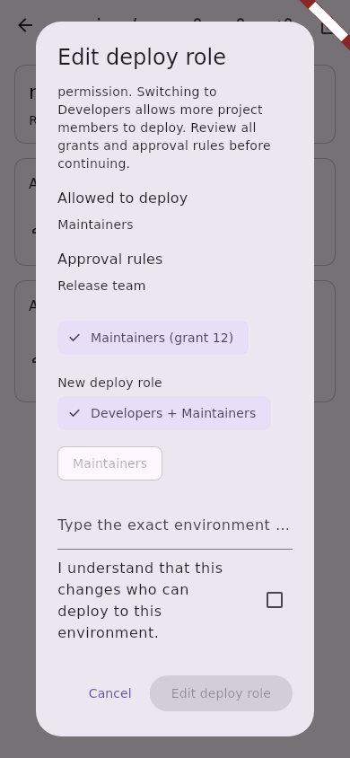
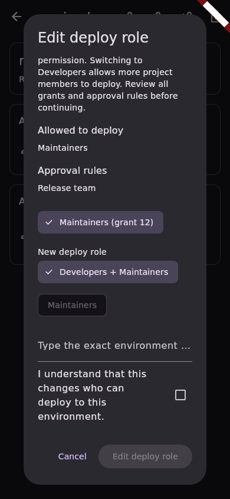
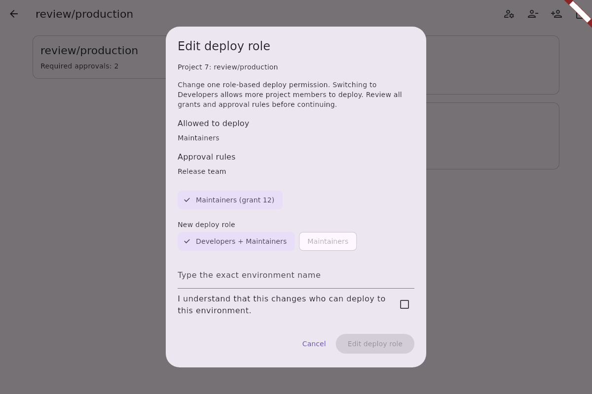
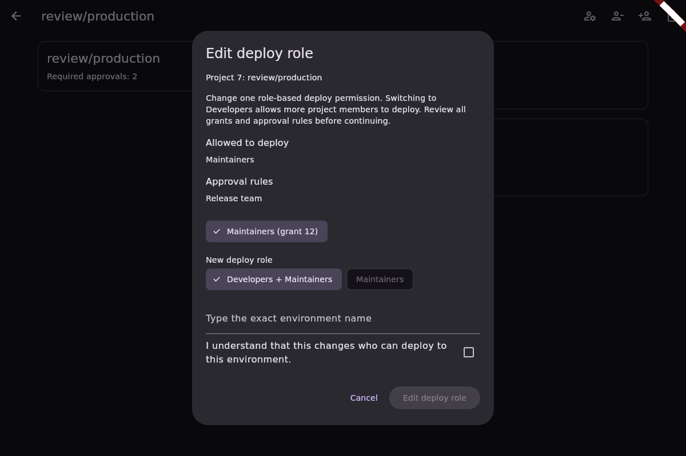

# Project protected environment deploy-role editing

This slice changes one role-based deploy grant between Developers and Maintainers.
It uses the existing project protected-environment detail route and one responsive
confirmation dialog. Group protection remains read-only. The change requires the
permissions and GitLab Premium/Ultimate tier documented by the
[protected environments API](https://docs.gitlab.com/api/protected_environments/#update-a-protected-environment).

The dialog first inspects every rule-list page and the complete matching rule.
The user selects a grant by its server-assigned ID and a different supported role,
enters the exact environment name, and acknowledges the access change. A role
already granted independently cannot be selected. Switching from Maintainers to
Developers broadens deployment access; the confirmation explains this.

Before dispatch, the controller compares a fresh complete rule with the confirmed
snapshot and validates that the selected ID still identifies one role-only grant.
It sends only `deploy_access_levels: [{id, access_level}]` in one PUT, with
redirects and authentication replay disabled. A complete follow-up read must match
the intended change, including every other grant and approval field. The selected
grant's server-generated role description may change. An uncertain result requires
an explicit read-only reload and new confirmation before another attempt.

The REST API does not offer an atomic compare-and-swap for this operation. The
preflight and follow-up reads detect observed changes but cannot prevent a race
with an external writer. An already dispatched request can affect the old account's
project after account replacement; its late result cannot update the new session.

The screenshots below use synthetic test data. They demonstrate layout, not a
live GitLab permission or tier check.

| Mobile light | Mobile dark |
| --- | --- |
|  |  |

| Desktop light | Desktop dark |
| --- | --- |
|  |  |
